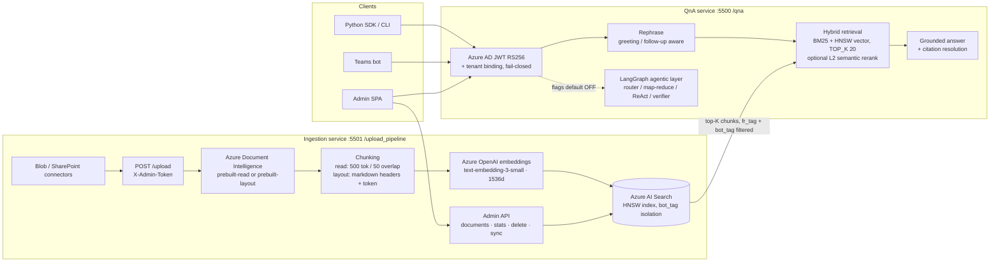

<div align="center">

# TocDoc — Enterprise RAG

**Source-available, multi-tenant, document-grounded Q&A platform,
deployed into each client's own Azure subscription.**

[](https://www.python.org/)
[](https://fastapi.tiangolo.com/)
[](https://python.langchain.com/)
[](https://azure.microsoft.com/)
[](LICENSE)

</div>

---

TocDoc ingests enterprise document corpora (PDF, DOCX, PPTX, HTML, MD, TXT) into
a hybrid vector index and answers natural-language questions with **cited,
grounded responses** — strictly constrained to the indexed corpus. It is built
for the deployment model where the **client operates the stack in their own
Azure tenancy**: no data leaves their subscription, and the orchestration code
is source-available for inspection.

Two stateless FastAPI services form the core:

| Service | Port | Path prefix | Responsibility |
|---|---|---|---|
| **Ingestion** | 5501 | `/upload_pipeline` | parse (Azure Document Intelligence) → chunk → embed → index; admin API; Blob/SharePoint connectors |
| **QnA** | 5500 | `/qna` | Azure AD JWT auth → tenant binding → rephrase → hybrid retrieve → grounded answer + citations; SSE streaming |

Around them: a typed **Python SDK** (+CLI, +LangChain retriever), a **Microsoft
Teams bot**, an **admin web dashboard** (React SPA), a **RAGAS evaluation
harness**, **Locust load tests**, and IaC for three deployment shapes
(**Bicep** → Azure Container Apps, **Terraform** mirror, **Helm** → AKS).

## Project status — honest snapshot

- **Shipped:** the two services with fail-closed security defaults, admin API,
  connectors, SSE streaming, structured error contract, request-ID
  observability, SDK, Teams bot adapter, admin SPA, eval harness, IaC — ~740
  hermetic tests across the seven required CI suites, gated by 13 required
  checks (hard pip-audit gate, 60% coverage floor on the two services, CodeQL).
  The admin SPA and Docker images build/test as advisory CI jobs.
- **Built but dark:** the P3 agentic layer (LangGraph router / map-reduce /
  ReAct / self-critique) ships behind default-OFF flags
  (`QNA_AGENT_ENABLED` + per-node flags). Enabling it is gated on an
  architect-signed ADR and a staged rollout — it is **not validated
  end-to-end**. See `docs/deployment/P3_ENABLEMENT.md`.
- **Contract-only:** `page_citations` exists in the response schema but is never
  populated — page-level ingestion awaits a reindex decision (ADR 09).
- **Not yet done:** no live-Azure validation has ever been run
  (`docs/deployment/SMOKE_TEST.md` is the mandatory pre-production gate); no
  release tag has been cut; the BSL license placeholders (Licensor, Change
  Date) are pending; PyMuPDF's AGPL license is an open sellability blocker
  (`docs/LICENSE_COMPLIANCE.md`).

## Architecture



Multi-tenancy is enforced at the retrieval layer: every chunk carries a
`bot_tag`, every query is filtered by it, and the QnA service **fails closed**
(403 before any search) if a token's tenant isn't mapped to the requested
`bot_tag`. Full tour: [`docs/ARCHITECTURE.md`](docs/ARCHITECTURE.md).

## Security defaults that will surprise a naive deploy

These shipped fail-closed on purpose (see `docs/RESUME.md`):

- **Tenant binding is ON by default** — `QNA_ENFORCE_TENANT_BINDING=true`
  requires `QNA_TENANT_BOT_TAG_MAP` (JSON `{tenant_id: [bot_tag, …]}`); missing
  or unparseable map ⇒ 403 on every request. Single-workspace deployments must
  configure the map or explicitly opt out.
- **Ingestion `/upload` and all `/admin/*` routes require `X-Admin-Token`**;
  an unset `ADMIN_API_TOKEN` makes the service refuse (503) rather than open up.
- **Ingestion ingress is internal by default** in Bicep/Terraform
  (`ingestionIngressExternal=false`); QnA stays external (JWT-authed).
- App-level rate limiting (429 + `Retry-After`) on `/qna` and `/upload` —
  per-process, so multi-replica deployments still need ingress-level limits.

Posture summary: [`SECURITY.md`](SECURITY.md). Vulnerability reports via GitHub
Security Advisories.

## Repository layout

```
services/qna/           QnA service                      services/ingestion/    Ingestion service
services/teams-bot/     Teams (Bot Framework) adapter    clients/python/        tocdoc-sdk + CLI + LangChain retriever
web/                    Admin dashboard SPA (React 18)   eval/                  RAGAS eval harness (own frozen dep set)
tests/integration/      Hermetic cross-service e2e       loadtest/              Locust scenarios
infra/                  Bicep + Terraform (Container Apps, Key Vault, Search, OpenAI, Doc Intelligence)
charts/tocdoc/          Helm chart for AKS               docs/                  MkDocs site (GitHub Pages)
```

## Getting started (local)

Python **3.12**. Each component installs its own pinned closure.

```bash
# Services (two terminals, or docker compose up --build)
pip install -r services/qna/requirements.txt
uvicorn app:app --port 5500 --reload   # from services/qna — needs env, see below

pip install -r services/ingestion/requirements.txt
uvicorn app:app --port 5501 --reload   # from services/ingestion

# Docs & health once running
#   http://localhost:5500/qna/docs          http://localhost:5500/qna/health
#   http://localhost:5501/upload_pipeline/docs   http://localhost:5501/upload_pipeline/health
```

Configuration is env-var driven (canonical UPPER_SNAKE names with Key Vault
dual-read on QnA). Copy each service's `.env.example`, see
[`docs/CONFIGURATION.md`](docs/CONFIGURATION.md) for the reference and
[`docs/RESUME.md`](docs/RESUME.md) for the fail-closed tenant-binding and
feature-flag variables, and [`docs/LOCAL_DEV.md`](docs/LOCAL_DEV.md) for the
quickstart (including the Intel-Mac `cryptography` build caveat).

### Tests

```bash
pytest services/qna/test           # 260 tests (also: pip install pytest pytest-asyncio — test deps are not in requirements.txt)
pytest services/ingestion/test    # 247 tests (needs requirements-dev.txt too)
pytest clients/python/tests        # 86 tests  (pip install -e "clients/python[dev]")
pytest services/teams-bot          # 35 tests
pytest eval                        # 49 tests  (own venv — frozen langchain 0.3.x, do not merge with service deps)
pytest tests/integration           # 35 tests  (install BOTH services' requirements into one env)
cd web && npm ci && npm test       # 10 tests  (Node 22.13 in CI)
```

## API in one glance

Full on-the-wire reference (payloads, SSE frames, error envelope):
[`docs/API.md`](docs/API.md).

| Endpoint | Auth | Purpose |
|---|---|---|
| `POST /qna/qna` | Azure AD JWT | grounded answer: `{answer, citation{file: path}}` |
| `POST /qna/qna/stream` | Azure AD JWT | SSE token stream + final citation event |
| `POST /upload_pipeline/upload` | X-Admin-Token | ingest file/folder (`bot_tag`, `fr_mode=read\|layout`) |
| `GET/DELETE /upload_pipeline/admin/documents…` | X-Admin-Token | list / inspect / delete documents |
| `GET /upload_pipeline/admin/index/stats` | X-Admin-Token | index counts & breakdowns |
| `POST /upload_pipeline/admin/connectors/{blob\|sharepoint}/sync` | X-Admin-Token | 202 + run_id, poll via `…/connectors/runs` |
| `GET /{prefix}/health` | public | liveness |

Errors use a stable envelope `{error: {code, message, request_id}}` with
`X-Request-ID` correlation on every response.

## Deployment

Three supported shapes, one contract (see
[`docs/deployment/INSTALLATION.md`](docs/deployment/INSTALLATION.md)):

- **Bicep → Azure Container Apps**: `infra/main.bicep` provisions OpenAI,
  AI Search, Document Intelligence, Key Vault (purge-protected), Log Analytics,
  App Insights, and both Container Apps. `az deployment group create …`
- **Terraform**: `infra/terraform/` — same resources, Key Vault-referenced
  secrets, user-assigned identity.
- **Helm → AKS**: `charts/tocdoc/` — HPA, PDB, NetworkPolicy, Key Vault CSI,
  ServiceMonitor (all optional-off; `values-production.yaml` enables the
  recommended set).

Container images publish to GHCR (`tocdoc-qna`, `tocdoc-ingestion`) on `v*`
tags via `release.yml` (no tag cut yet). **Before any client traffic, run the
live smoke runbook:** [`docs/deployment/SMOKE_TEST.md`](docs/deployment/SMOKE_TEST.md).

## CI

`ci.yml` enforces 13 required checks on `main`: ruff, bandit + **pip-audit as a
hard gate**, Bicep build, Helm lint, shellcheck, seven test suites (qna,
ingestion, sdk, eval, teams-bot, integration, loadtest — the 60% coverage
floor applies to the qna/ingestion legs), and CodeQL. Advisory (non-blocking) jobs build/boot both Docker images
and build/test the web SPA. Dependabot is grouped per dependency family; the
repo convention for shared service pins is documented in
[`docs/RESUME.md`](docs/RESUME.md).

## Documentation

The MkDocs site (deployed by CI to GitHub Pages) indexes everything:
[`docs/README.md`](docs/README.md). Key entries: architecture tour, API and
configuration references, day-2 operations runbook, threat model, license
compliance audit, ADRs, and the resume-from-cold guide
([`docs/RESUME.md`](docs/RESUME.md)) — the most current status document.
AI-agent operating guide: [`CLAUDE.md`](CLAUDE.md).

## License

TocDoc is **source-available** under the
[Business Source License 1.1](LICENSE):

- ✅ Free for non-production use — development, testing, evaluation, research.
- ⛔ Offering TocDoc (or a derivative) as a competing hosted/managed/embedded
  service requires a commercial license.
- 🔄 Each version converts to **Apache 2.0** on its Change Date.

> Note: the LICENSE currently carries placeholder legal parameters (Licensor
> entity, Change Date) pending confirmation, and one dependency
> (PyMuPDF, AGPL-3.0) has an open compliance decision — see
> [`docs/LICENSE_COMPLIANCE.md`](docs/LICENSE_COMPLIANCE.md).

---

<div align="center">

FastAPI · LangChain 1.x / LangGraph · Azure OpenAI · Azure AI Search · Azure Document Intelligence

</div>
